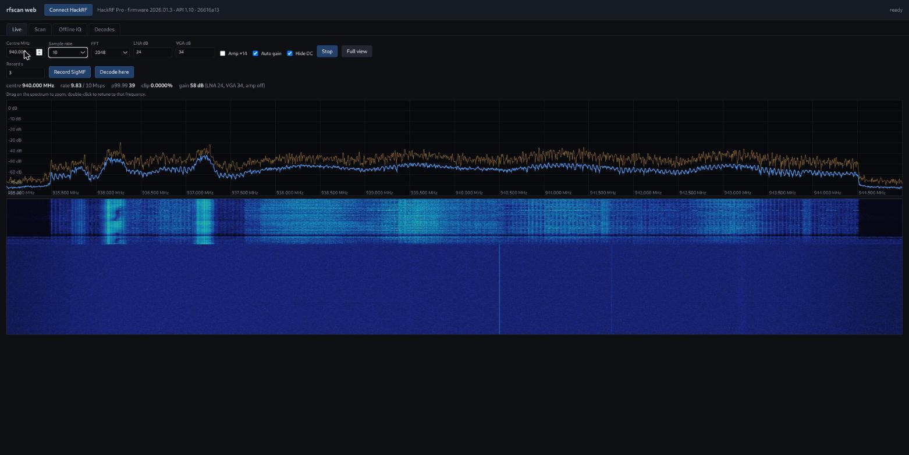
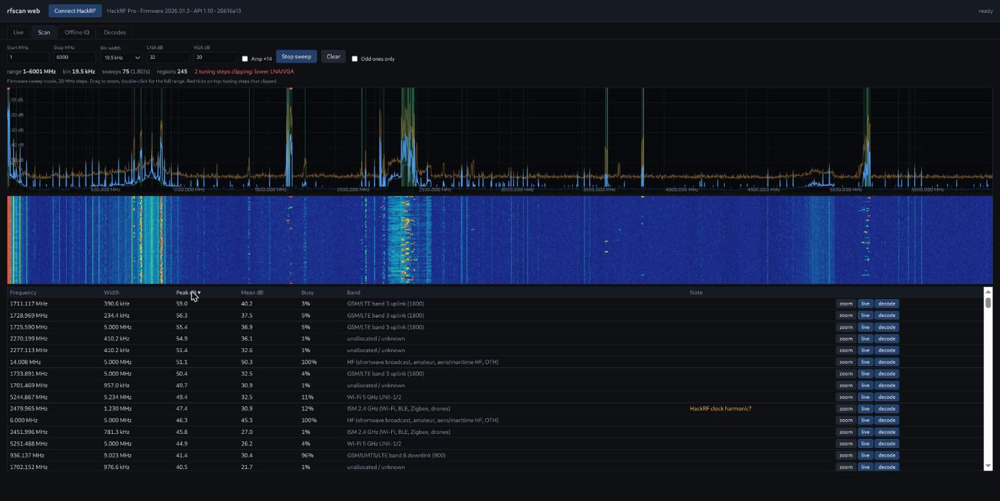
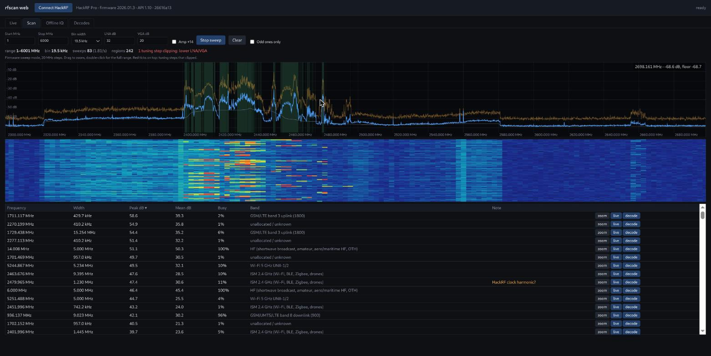
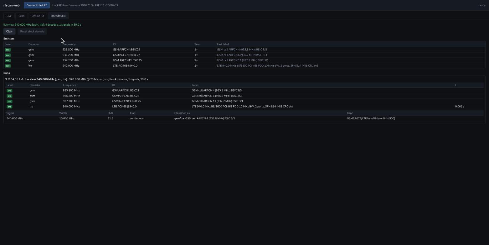
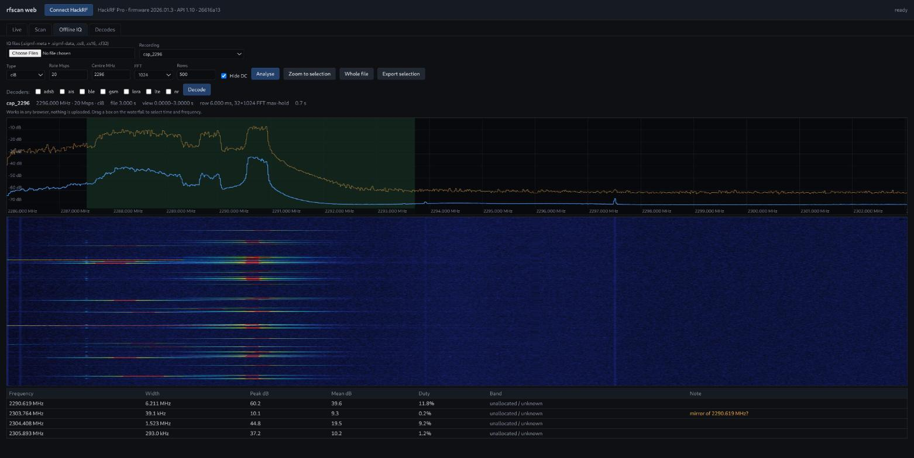
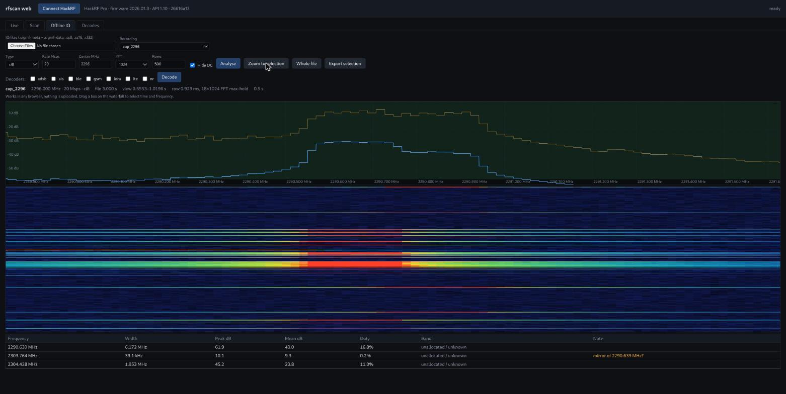
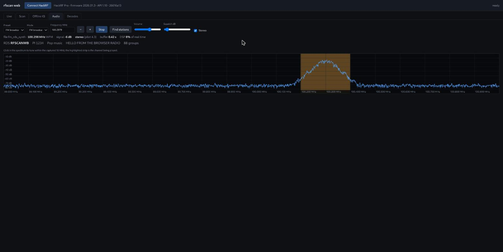
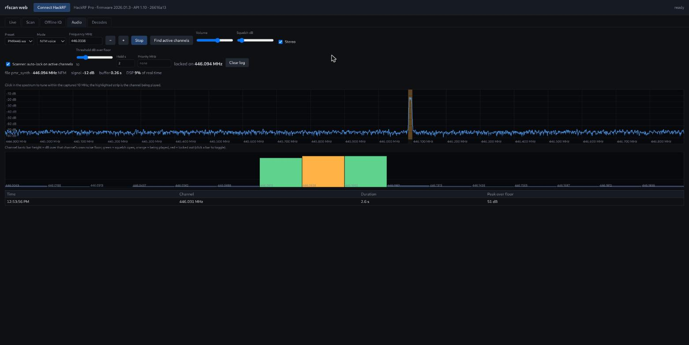
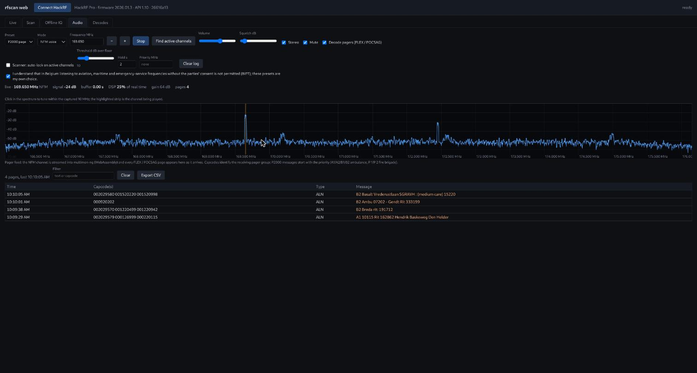

# rfscan — autonomous HackRF RF environment scanner

Surveys 1 MHz – 6 GHz, locks on to where the energy is, sets gain by itself, classifies
what it finds against a Netherlands/CEPT band plan, runs protocol decoders (to CRC level
where the protocol has one), and keeps IQ only for the relevant parts. Works live, or
afterwards on stored IQ (SigMF or raw cs8/cu8/cs16/cf32).

```
./setup.sh                          # once: apt packages, libhackrf (HackRF Pro), gr-lora_sdr, venv
./rfscan.sh decoders                # what is available
./rfscan.sh scan --duration 1800    # live; Ctrl-C to stop; report at runs/<time>/report.html
./rfscan.sh survey --seconds 20     # just the wideband energy survey
./rfscan.sh analyze runs/<time>/iq  # re-run classification + decoders on saved IQ
./rfscan.sh analyze rec.cs8 --rate 2 --freq 433.92      # raw hackrf_transfer file
./rfscan.sh capture 868.0 4 30 out/srd868               # one auto-gain capture to SigMF
./rfscan.sh report runs/<time>
```

## In the browser (no install)

**https://pimo131.github.io/HackRF-toolkit/** runs the same tool in Chrome or Edge over WebUSB:
plug in the HackRF, click *Connect*, and you get the live spectrum/waterfall with auto-gain,
the 1–6000 MHz sweep scan with band labels, SigMF recording, and the decoders. The decoders are
the Python modules from `rfscan/` running in [Pyodide](https://pyodide.org), plus multimon-ng
and rtl_433 compiled to WebAssembly, so results match the native tool. Offline analysis of
SigMF files works in any browser; nothing is uploaded.

| | |
|---|---|
|  **Live:** spectrum, waterfall and auto-gain; GSM carriers and an LTE cell at 900 MHz |  **Scan:** 1–6000 MHz sweep with detected regions, band labels and a sortable table |
|  **Scan, zoomed:** Wi-Fi and BLE around 2.4 GHz; green = detected regions |  **Decodes:** one click on the 900 MHz band gives 3 GSM cells and an LTE MIB with CRC |
|  **Offline IQ:** a 120 MB SigMF file analysed in the browser in 0.7 s |  **Offline, zoomed:** box-select on the waterfall re-analyses just that time span |
|  **Audio:** live FM stereo with RDS (station name, PI, programme type, RadioText), NFM and AM, band scan for stations; plays recordings too |  **Scanner:** squelch on every channel of the band at once, auto-lock on the active one, hold, priority, lockouts and a log of transmissions |
|  **Pager feed:** the NFM channel streams into multimon-ng (WebAssembly); live P2000 FLEX pages appear as they arrive, with filter and CSV export | |

The **Audio** tab is a receiver: FM broadcast in stereo with RDS, narrowband FM (PMR446, amateur)
and AM, with presets, squelch, a band scan that lists the stations it hears, and playback of any
loaded recording. Its **scanner** mode watches every channel of the preset's grid in the captured
10 MHz at once (one FFT per block, a local noise floor per channel), plays whichever channel opens
its squelch, holds after it closes, honours a priority channel and lockouts, logs each transmission,
and hops the radio between 10 MHz windows for bands wider than one capture. With **Decode pagers**
ticked (preset "P2000 pagers", opt-in), the demodulated NFM channel is streamed at 22.05 kHz into
multimon-ng's FLEX/POCSAG decoders inside the audio worker (`web/tools/src/mm_stream.c` adds the
streaming entry points to the WebAssembly build) and every page is listed live with capcodes, type
and text. The same path decodes **APRS/AX.25 (AFSK1200), DTMF, ZVEI/CCIR/EEA/EIA selcall and
Morse**, and **ISM sensors via rtl_433** (433 MHz remotes and weather sensors, 868 MHz wM-Bus meters,
`web/rtl433-live.js`) and **RS41 radiosondes** (rs1729/RS rs41mod as WebAssembly, `web/rs41-live.js`,
position on the map); extra **data VFOs** run more decoders on other channels of the same 10 MHz capture, so one
capture can play a voice channel while logging P2000, a POCSAG network and APRS at once. Modes are
WFM stereo, NFM (with **CTCSS** readout), AM, **USB/LSB/CW** (HF works on the HackRF Pro). There are
bookmarks, a **Record** button (WAV) and per-transmission recordings in scanner mode, and a **Map**
tab that plots ADS-B aircraft, AIS ships and APRS stations from the decoders. The header shows the
HackRF Pro extras: bias tee and CLKOUT. The DSP (`web/audio-worker.js`) is plain JavaScript in a
worker and uses about a quarter of one core per VFO at 10 Msps; audio goes out through an AudioWorklet.

Source is in `web/`. `web/build.sh` refreshes the Python copy in `web/py` after changes to
`rfscan/`; `web/build_tools.sh` rebuilds the two WebAssembly tools. GitHub Pages deploys `web/`
on every push to `main` (`.github/workflows/pages.yml`).

## How a scan works

1. **Survey** (`sweep.py`): `hackrf_sweep` over the range. Gain is calibrated per 20 MHz
   segment first: the highest LNA/VGA/amp step that stays linear and below the
   headroom limit. Statistics over many sweeps (linear mean plus hit rate above floor) give
   the energy regions. Sweep artefacts (20 MHz tuning-step spurs, the weak comb) are dropped.
2. **Plan** (`scheduler.py`): regions are clustered into 20 Msps capture windows, centred
   so narrow signals stay off the DC spike. Each window gets the wideband decoders the
   band plan suggests (LTE/NR/GSM/DAB/BLE). A fixed **watch list** covers bursty bands a
   sweep can't see: ISM 433, SRD 868, VHF 169 (P2000 / wM-Bus), ADS-B 1090, AIS, BLE ch38
   and PMR446.
3. **Dwell**: retune, **auto-gain** (`agc.py`: 100 ms probes, 99.99th percentile and clip
   fraction, LNA first, amp last, extra headroom on bursty bands), then capture to a
   RAM-disk SigMF file.
4. **Analyse** (`pipeline.py`, in a process pool so the radio keeps moving):
   * continuous carriers: mean plus max-hold PSD, channelise, features (OBW, envelope,
     duty, FSK levels, OFDM cyclic-prefix test for LTE/NR/Wi-Fi/DAB/DVB-T, TDMA periodicity)
     give a heuristic label;
   * watch bands: time-frequency burst detection and per-frequency clustering;
   * decoders run on the capture; their results override heuristic labels, and fragments
     inside a decoded carrier are folded into it;
   * **IQ retention**: channelised bursts (ci16 SigMF with per-burst annotations) and short
     channelised snippets of decoded or unidentified signals. The full 20 MHz capture is kept
     once per window when a cellular decoder locked. Everything else is deleted.
     `--storage-gb` caps the total.
5. Results go to `rfscan.sqlite`, `events.jsonl` and the live console, plus `report.html`
   (spectrum, decoded emitters, classified signals, links to the IQ).

## Decoders

| name | what | level | engine |
|---|---|---|---|
| `lte` | LTE PSS/SSS, PCI, then PBCH MIB (BW, ports, SFN) | CRC-16 | native numpy |
| `nr` | 5G NR SSB PSS/SSS: PCI, GSCN, SSB index | sync | native numpy |
| `gsm` | FCCH/SCH (BSIC) + BCCH SI3/4 (MCC/MNC/LAC/CI) | parity/CRC | native + gr-gsm |
| `adsb` | Mode S / ADS-B: ICAO, callsign, altitude, position, speed | CRC-24 | native + pyModeS |
| `ais` | AIS ch A/B: MMSI, position, ship name | CRC-16 | native |
| `ble` | BLE advertising ch 37/38/39: MAC, name, manufacturer | CRC-24 | native |
| `rtl433` | ~250 ISM protocols (sensors, remotes, TPMS, wM-Bus) | protocol CRC/checksum | rtl_433 |
| `lora` | LoRa CSS detect, SF/BW/sync word, full decode, LoRaWAN header | payload CRC | native + gr-lora_sdr |
| `pager` | P2000 FLEX (169.650) + POCSAG | BCH | multimon-ng |
| `dab` | DAB OFDM detect, then ensemble/services | FIC CRC | native + welle-cli |

Adding a decoder means dropping a module into `rfscan/decoders/` with `NAME`, `decode(rec, ctx)`
and optionally `CAPTURE`. See `rfscan/decoders/__init__.py`. Then map it in `bandplan.py`.

## Hardware notes

* **HackRF Pro** (board ID 5) needs libhackrf ≥ 2026.01 and firmware ≥ 2026.01.3. Older
  firmware silently ignores the sample rate. `setup.sh` builds the library into
  `third_party/prefix`, and rfscan uses it automatically.
* With libhackrf, changing frequency or sample rate *while streaming* corrupts samples
  (low-pass hump, I/Q imbalance). The driver (`hackrf.py`) therefore stops, reconfigures and
  restarts for every retune. Gain changes while streaming are safe.
* HF/LF below ~30 MHz and the FM/VHF band need a suitable antenna; HackRF sensitivity
  there is poor without one.
