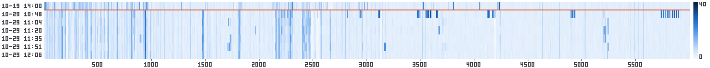

# Findings: what is on the air here (Antwerp area, BE/NL border)

Running log of what rfscan has identified off air, native and in the browser. Dates are run dates;
details live in `runs/<date>/report.html` (git-ignored) and the per-day reports in `docs/`.

## Decoded to CRC level

| Service | Where | First seen | Notes |
|---|---|---|---|
| GSM 900 | 926–960 MHz | 2026-10-19 | Belgian cells (MCC 206) on 10-19; on 10-29 the strongest were Dutch: KPN 204-08 LAC 3350, VodafoneZiggo 204-04 LAC 203. 45 cells with SI3/4 in total. |
| LTE | B1/3/7/8/20/28/32/69 | 2026-10-19 | 17 cells with MIB CRC on 10-19, 9 on 10-29 incl. the 1.5 GHz SDL band 32/75 (PCI 318, 58). |
| NR | n28, n78 | 2026-10-19 | PSS+SSS sync only, no MIB yet. |
| ADS-B | 1090 MHz | 2026-10-19 | Daily. 10-29: PH1391 and two others, one with full position. |
| AIS | 161.975 / 162.025 MHz | 2026-10-19 | Scheldt traffic; nothing in the short 10-29 dwells. |
| P2000 FLEX | 169.650 MHz | 2026-10-19 | Dutch emergency paging, ~4–5 pages/min at 10:00 on a weekday (171 pages in 38 min live in the browser on 10-29). |
| POCSAG 1200 | **172.4547 MHz** | **2026-10-29** | Private Dutch operator network: water-utility SCADA alarms, server event pages, tone-only pages. Found with the browser pager feed, confirmed by the monitor as new vs 10-19. |
| BLE advertising | 2402/2426/2480 MHz | 2026-10-19 | 189 distinct addresses in 90 min on 10-29. |
| Wireless M-Bus | 868.95 MHz | 2026-10-29 | One gas meter, mode C, manufacturer ELS. |
| DAB+ | 12A/12C (10-19), 9C (10-29) | 2026-10-19 | OFDM sync only; no DAB+ audio decoder. |

## Heard in the browser receiver
* FM broadcast 97.6, 102.7, 100.4, 90.0 MHz: audio fine, RDS too weak with the whip (~11 dB C/N).
* PMR446: quiet on a weekday morning.
* APRS 144.800 MHz: nothing heard in a 5 min evening window on 10-29 (whip, indoors).

## Seen, not decodable
* TETRA (ASTRID/C2000) 390.5, 392.3, 393.2, 396.0 MHz: encrypted (TEA2), never decodable.
* **2.27–2.29 GHz bursts**: 2270.2 / 2277.1 MHz on 10-28 (410 kHz wide, 51–55 dB), 2284.6 / 2289.8 MHz on 10-29
  (1.3–2.1 MHz wide, 15–22 dB, present in every survey, absent on 10-19). Unidentified. Candidates: 2.3 GHz
  amateur (2300–2450 is the 13 cm band, below 2300 is not), video links / PMSE, or a local wideband link.
  Next step: a 20 MHz capture at 2285 MHz with the classifier, then look at the burst timing.
* 5.7–5.9 GHz unidentified regions only in the first (noisiest) survey of 10-29: likely sweep artefacts.

## Long-term monitoring (10-29 vs 10-19 baseline)
`./rfscan.sh monitor runs/20261029_104759 --baseline iq_archive/2026-10-19_antwerp/scan1_full_1400`

45 persistent new signals vs the 10-19 baseline. Besides the two above: GSM 900 DL at 940 MHz +32 dB
(different serving cell), LTE B20 813 MHz, B32 SDL 1471/1478 MHz, DME 1120 MHz, TETRA 384.5 MHz,
29.1 MHz HF, several 2.4 / 5.2 GHz Wi-Fi channels. Band occupancy: P2000 100 % in 5 of 6 surveys,
TETRA 17 % falling to 4 %, LTE B20 DL 20–25 % steady, ISM 433 0–22 %.
